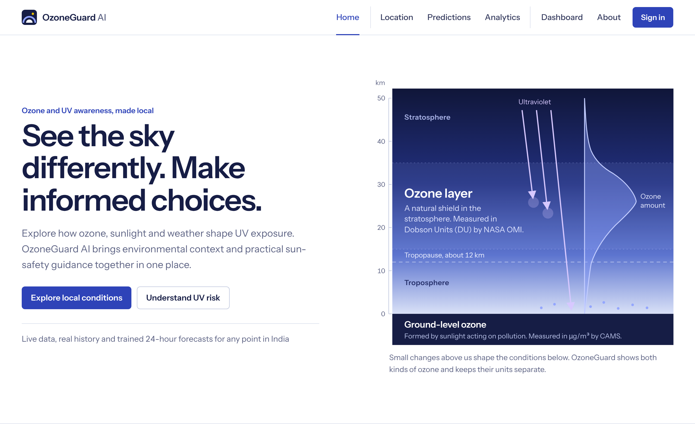
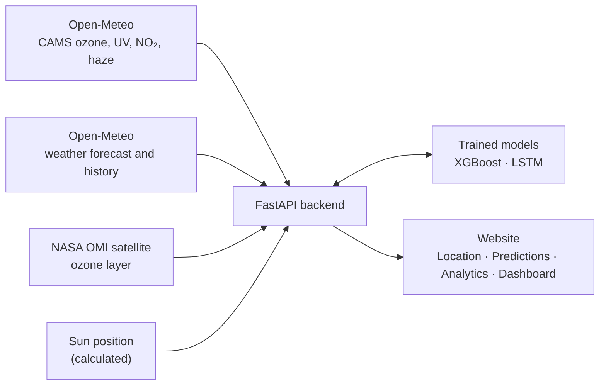
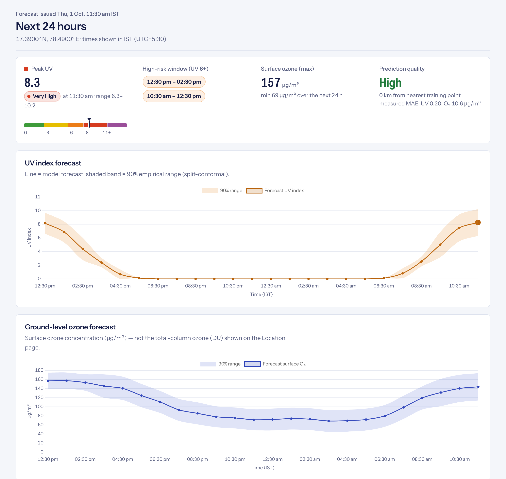

<p align="center">
  <picture>
    <source media="(prefers-color-scheme: dark)" srcset="docs/assets/ozoneguard-logo-dark.svg">
    
  </picture>
</p>

<p align="center">
  <b>Ground-level ozone and UV for any point in India.</b><br>
  What happened, what is happening now, and what the next 24 hours look like.
</p>

<p align="center">
  
  
  
  
  
</p>

<p align="center">
  <a href="#getting-started">Getting started</a> ·
  <a href="#how-the-forecast-works">How the forecast works</a> ·
  <a href="#api">API</a> ·
  <a href="docs/scientific-limitations.md">Limitations</a>
</p>

<br>

<p align="center">
  
</p>

## What is OzoneGuard AI?

UV exposure in India is high for much of the year, and ground-level ozone is one of the pollutants that builds up on hot, sunny afternoons. The numbers that describe both are out there, but they are spread across satellite products, atmospheric models and weather services, each with its own units and format.

OzoneGuard AI brings them together in one website. Pick any point in India and you can see:

- **Now:** current weather, UV index and risk level, the place name, and the thickness of the ozone layer overhead from NASA's satellite.
- **Next 24 hours:** an hourly forecast of ground-level ozone and UV from our own trained models, with an honest range around each value.
- **The past:** daily ozone, UV and weather history since August 2022, with typical patterns by hour and how the variables move together.

It is an educational project, not an official warning service. Every number on the site comes from a real data source or a trained model; if a source is down, the site says so instead of showing a made-up value.

## Features

- **Any point in India.** Click the map, use your GPS, type coordinates, or choose one of 38 cities from the Quick pick list. Points in the sea or in neighbouring countries are rejected.
- **Two forecast models.** XGBoost (the default) and an LSTM neural network, trained on the same data. You can switch between them on the Predictions page.
- **Ranges you can trust.** Each forecast comes with a 90% range, calibrated so that about 9 in 10 past outcomes fell inside it.
- **UV risk in plain terms.** WHO risk levels, the peak hour, and the hours when UV is 6 or higher.
- **History and patterns.** Any period since 4 August 2022, up to a year at a time, grouped by day, week or month.
- **Saved places.** Keep the places you check often. They stay in your browser, or sync across devices if you sign in.
- **Works on phones.** Every page adapts to small screens.

## How it fits together



The backend is a single Python process. It fetches the data, runs the models and serves the website, so there is nothing else to set up. The trained models are included in the repository, so you do not need to train anything to run the site.

## How the forecast works

<p align="center">
  
</p>

**What it predicts.** Hourly values for the next 24 hours of:

- **ground-level ozone**, in µg/m³, the pollutant we breathe
- **the UV index**, including the effect of clouds

Ground-level ozone is not the ozone layer. The ozone layer sits 15 to 35 km up and is shown separately, in Dobson Units, on the Location page.

**What it learns from.** For each forecast the model looks at:

| Group | What it includes |
|---|---|
| Recent values | Ozone or UV now, 3 hours ago, at the same hour yesterday and two days ago, and the last 24 hours' average and peak |
| Other pollutants | Nitrogen dioxide (a key ingredient of ozone) and haze, which blocks sunlight |
| Weather forecast | Temperature, humidity, cloud, rain, sunlight reaching the ground, wind and pressure for the target hour |
| Sun position | How high the sun is, the time of day and the time of year |
| Place | Latitude, longitude and elevation |

The training data has 1.39 million hourly rows from 38 places across all six regions of India, from August 2022 to October 2026. Thirty places are used for training. The other eight are never shown to the models and are kept aside to check how well the forecasts work for places the models have not seen.

**How accurate it is.** Average error over a full test year (October 2025 to October 2026), compared with the simple guess "same as this hour yesterday". Lower is better.

| | XGBoost | LSTM | Same hour yesterday |
|---|---:|---:|---:|
| Ozone, 30 training places | 10.6 µg/m³ | **10.3 µg/m³** | 13.2 µg/m³ |
| Ozone, 8 unseen places | **11.0 µg/m³** | 11.2 µg/m³ | 12.3 µg/m³ |
| UV index, 30 training places | 0.196 | **0.194** | 0.281 |
| UV index, 8 unseen places | **0.205** | 0.209 | 0.280 |

The LSTM is slightly better for the places it was trained on and for the first few hours. XGBoost is slightly better for new places, which is why it is the default.

**What to keep in mind.** The models learn to reproduce CAMS, the European atmospheric model, which works on a grid of roughly 45 km. That means the forecasts describe the area around a point, not a single street, and they have not yet been compared with readings from ground monitoring stations. The [limitations page](docs/scientific-limitations.md) explains this in more detail.

## Getting started

### What you need

- Python 3.10 or newer
- An internet connection (the site fetches live data, maps and charts)
- Optional: a free [NASA Earthdata](https://urs.earthdata.nasa.gov/) token, if you want the ozone-layer reading on the Location page

### Run it on your computer

**1. Set up** (once), from the project folder:

```powershell
python -m venv .venv
.\.venv\Scripts\python.exe -m pip install -r requirements.txt
Copy-Item .env.example .env
```

<details>
<summary>On macOS or Linux</summary>

```bash
python3 -m venv .venv
.venv/bin/python -m pip install -r requirements.txt
cp .env.example .env
```

</details>

If you have a NASA token, paste it into `.env` as `NASA_EARTHDATA_TOKEN`. Tokens last about 60 days. Everything else works without one.

**2. Start the server**:

```powershell
.\.venv\Scripts\python.exe -m uvicorn backend.main:app --port 8000 --reload
```

On macOS or Linux, use `.venv/bin/python` instead of `.\.venv\Scripts\python.exe`.

**3. Open [http://localhost:8000](http://localhost:8000)** in your browser. The interactive API documentation is at [http://localhost:8000/docs](http://localhost:8000/docs). To stop the server, press <kbd>Ctrl</kbd>+<kbd>C</kbd> in the terminal.

> [!TIP]
> Running Python from inside `.venv` keeps working even if you move or rename the project folder, which breaks the usual `Activate.ps1` script.

### Run it with Docker

```bash
docker compose -f deployment/docker-compose.yml up --build
```

Then open [http://localhost:8000](http://localhost:8000). Docker reads the same `.env` file.

### If something goes wrong

| What you see | What to do |
|---|---|
| `No Python at ...` or `did not find executable` | The `.venv` folder was created somewhere else. Delete it and repeat step 1. |
| "Cannot reach the OzoneGuard backend" on the page | The server is not running, or it stopped. Start it again (step 2). |
| "The service could not be reached" | Check your internet connection. If it is fine, the data provider may be down; try again in a few minutes. |
| The ozone-layer panel says the token was rejected | Your NASA token has expired. Create a new one and update `.env`. |

The site works on any port. If you open the pages through VS Code Live Server (port 5500 or 5501) instead, they look for the backend at `http://127.0.0.1:8000`.

## Using the site

The menu runs **Home · Location · Predictions · Analytics · Dashboard · About**.

| Page | What you can do |
|---|---|
| **Location** | See current conditions for one point: weather, UV and its risk level, the place name, and the ozone layer overhead. |
| **Predictions** | Get the 24-hour ozone and UV forecast, with ranges, the peak UV hour and the high-risk window. Choose XGBoost or LSTM from the *Model* list. |
| **Analytics** | Explore history for any period since 4 August 2022: daily, weekly or monthly values, the average day, and how ozone, UV and weather relate. |
| **Dashboard** | See now, the next 24 hours and the last 14 days for one place, plus your saved places. |
| **About** | Read about the project, its data and the science behind it. |

On Location, Predictions and Analytics, the **Quick pick** list has the 38 cities the models were built on, grouped by region, with your saved places at the top. Picking a city loads it straight away. If you click the map or type other coordinates instead, the list switches back to *Custom point*.

## API

Everything the website shows comes from these endpoints, so you can use them directly. Full details are in the [API documentation](docs/api-documentation.md), or at `/docs` while the server is running.

| Endpoint | Returns |
|---|---|
| `GET /api/v1/health` | Whether the server is up |
| `GET /api/v1/location/validate?lat=&lon=` | Whether a point is inside India |
| `GET /api/v1/location/presets` | The 38 Quick pick cities |
| `GET /api/v1/location/overview?lat=&lon=` | Current weather, UV, place name and ozone layer |
| `GET /api/v1/ozone/current?lat=&lon=` | NASA ozone-layer reading |
| `GET /api/v1/predictions/24h?lat=&lon=&model=` | The 24-hour forecast (`model` is `xgboost` or `lstm`, optional) |
| `GET /api/v1/predictions/model-info?model=` | Model details and test accuracy |
| `GET /api/v1/predictions/models` | Both models side by side |
| `GET /api/v1/analytics/history?lat=&lon=&start=&end=` | History for a period |
| `GET /api/v1/analytics/limits` | The earliest and latest dates available |

For example, the forecast for Hyderabad:

```bash
curl "http://localhost:8000/api/v1/predictions/24h?lat=17.385&lon=78.4867"
```

When a data source is unavailable, the API answers with HTTP 503 and a short explanation rather than an estimate.

## Project structure

```text
OzoneGuard-AI/
├── backend/          FastAPI app: API routes, data services, settings
├── frontend/         The website: one HTML file per page, plus js/ and css/
├── ml/               Data collection, cleaning, features, training and reports
│   └── experiments/  One-off experiments, kept separate from the pipeline
├── models/           Trained models (xgboost/, lstm/) and climatology
├── data/             A small sample for the tests; station files for validation
├── docs/             Method, results, limitations and setup guides
├── tests/            The pytest suite
├── deployment/       Dockerfile and docker-compose.yml
└── firebase/         Security rules for accounts and saved places
```

## Retraining the models

You only need this to rebuild the dataset or the models. The site runs on the models already in `models/`.

```bash
python -m ml.collect_data fetch       # download the data (slow)
python -m ml.preprocess               # clean and align
python -m ml.features                 # build the training tables
python -m ml.correlation              # correlation analysis and figures
python -m ml.train_xgboost            # -> models/xgboost/
python -m ml.train_lstm               # -> models/lstm/  (needs: pip install -r requirements-lstm.txt)
python -m ml.compare_models           # -> docs/model-comparison.md
python -m ml.report                   # -> docs/ml-results.md
```

If you already have the saved training export, skip the download and load it instead:

```bash
python -m ml.collect_data import-export data/raw/browser_export/ozoneguard_training_data.csv.gz
```

PyTorch is only needed to train the LSTM. The website runs it with plain NumPy.

To check the forecasts against real monitoring stations, put hourly station files in `data/external/stations/` (CPCB exports work) or use an OpenAQ API key:

```bash
python -m ml.validate_ground_truth csv data/external/stations/*.csv
python -m ml.validate_ground_truth openaq --start 2026-01-01 --end 2026-03-31
```

## Running the tests

```powershell
.\.venv\Scripts\python.exe -m pytest -q
```

The 99 tests cover data cleaning and features, both models, the India boundary, the API, the NASA reader, the station check and the error messages. They run offline, using the small sample in `data/samples/`.

## Accounts (optional)

The whole site works without an account. Saved places are then kept in your browser. To let people sign in and keep their places on every device, connect your own Firebase project by following the [Firebase setup guide](docs/firebase-setup.md). It takes about ten minutes. The included security rules let each person see, add and remove only their own places.

Never commit your `.env` file or any token; `.env` is already excluded from Git.

## Documentation

| Read this | To learn about |
|---|---|
| [Scientific limitations](docs/scientific-limitations.md) | What the numbers can and cannot tell you |
| [ML results](docs/ml-results.md) | Full evaluation of the XGBoost models |
| [XGBoost vs LSTM](docs/model-comparison.md) | The two models compared on the same test data |
| [Prediction pipeline](docs/prediction-pipeline.md) | How a live forecast is built, step by step |
| [Data sources](docs/prediction-data-sources.md) and [provenance](docs/data-provenance.md) | Where every value comes from |
| [Data quality](docs/data-quality-report.md) and [leakage audit](docs/data-leakage-audit.md) | How the data was checked |
| [Extra factors experiment](docs/experiments/extra-factors-experiment.md) | Two extra inputs that were tested and not added |
| [Architecture](docs/architecture.md) and [decisions](docs/architecture-decisions.md) | How the code is organised, and why |
| [API documentation](docs/api-documentation.md) | Every endpoint, input and response |
| [Firebase setup](docs/firebase-setup.md) | Turning on accounts |

## Data sources and credits

- **Atmospheric data:** contains modified Copernicus Atmosphere Monitoring Service information ([CAMS](https://atmosphere.copernicus.eu/)), 2022 to 2026.
- **Weather data:** [Open-Meteo](https://open-meteo.com/), licensed under [CC BY 4.0](https://creativecommons.org/licenses/by/4.0/).
- **Ozone layer:** NASA OMI satellite product OMTO3G, via [NASA Earthdata](https://www.earthdata.nasa.gov/).
- **Maps:** © [OpenStreetMap](https://www.openstreetmap.org/copyright) contributors, drawn with [Leaflet](https://leafletjs.com/).
- **UV risk levels:** the World Health Organization's [Global Solar UV Index](https://www.who.int/news-room/questions-and-answers/item/radiation-the-ultraviolet-(uv)-index).

---

<sub>OzoneGuard AI is an educational project. It is not an official air-quality or UV warning service, and nothing on the site is medical advice.</sub>
