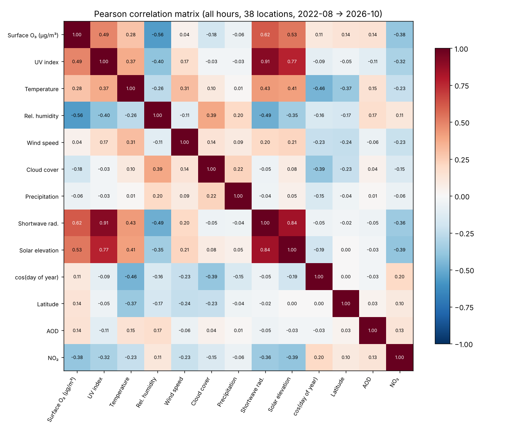
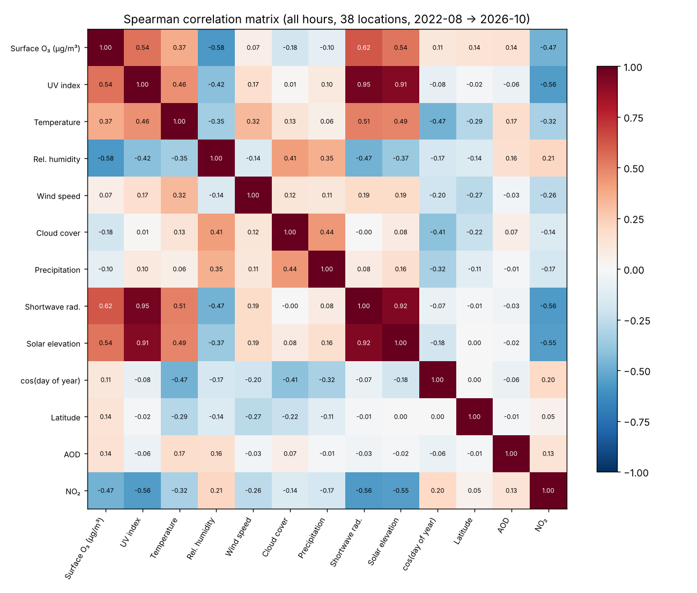
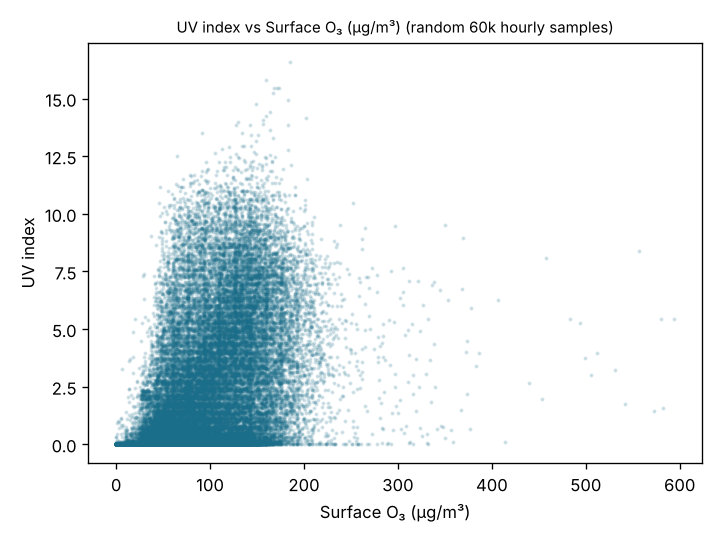
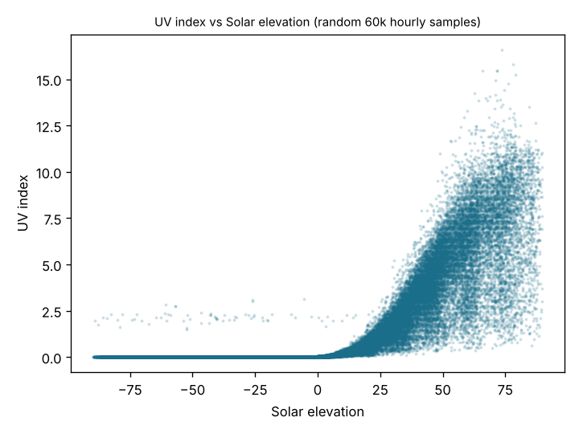
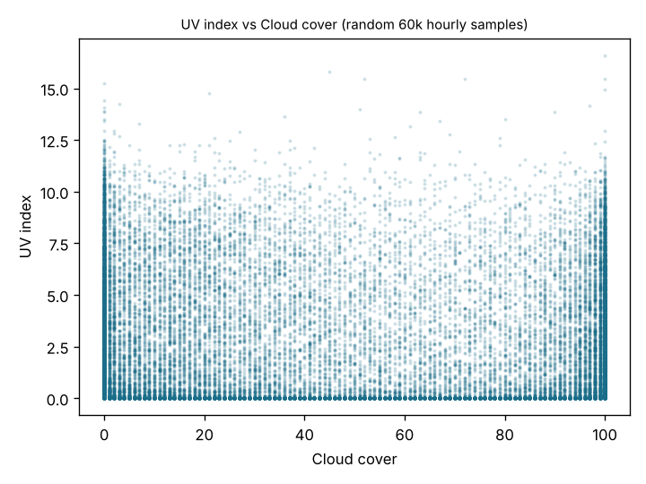
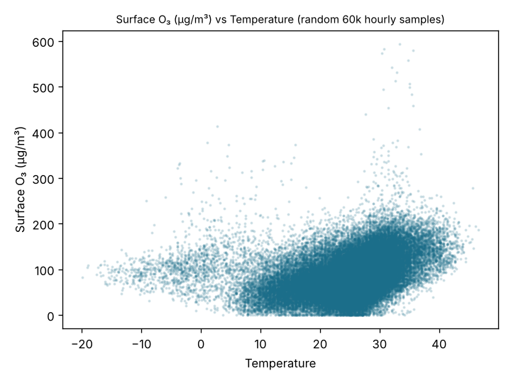
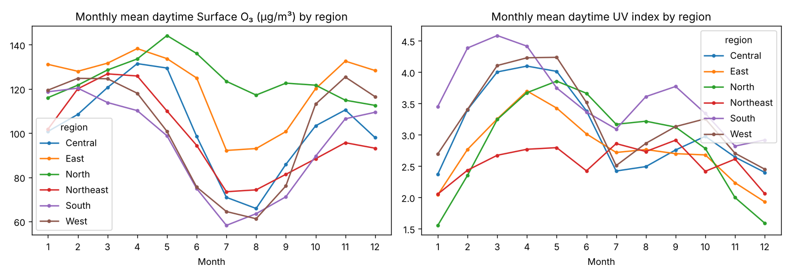
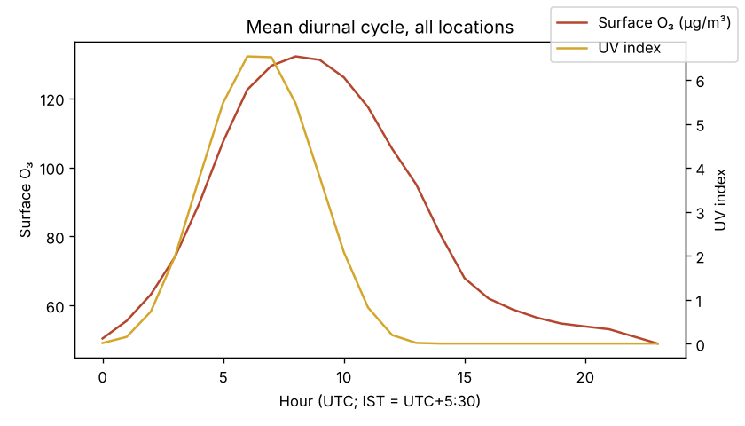

# Correlation analysis (PAST)

Computed by `python -m ml.correlation` on the cleaned hourly dataset (1,389,888 location-hours, 38 locations, Aug 2022 → Oct 2026, UTC). Values below are measured, not assumed.

**Correlation ≠ causation.** Both ozone and UV follow the sun, so the 'all hours' coefficients are dominated by the shared diurnal cycle. The *daytime* columns restrict to solar elevation > 5°, and the *anomaly* column removes the location × month × hour mean from both variables (daytime only), which isolates day-to-day co-variation.

| Pair | Pearson (all) | Spearman (all) | Pearson (day) | Spearman (day) | Pearson anomaly (day) | n (all) |
|---|---|---|---|---|---|---|
| Surface O₃ (µg/m³) ↔ UV index | 0.488 | 0.545 | 0.304 | 0.342 | 0.173 | 1,389,752 |
| Surface O₃ (µg/m³) ↔ Temperature | 0.285 | 0.368 | 0.234 | 0.338 | 0.248 | 1,389,752 |
| Surface O₃ (µg/m³) ↔ Rel. humidity | -0.557 | -0.577 | -0.564 | -0.614 | — | 1,389,752 |
| Surface O₃ (µg/m³) ↔ Wind speed | 0.042 | 0.069 | -0.139 | -0.121 | — | 1,389,752 |
| Surface O₃ (µg/m³) ↔ Cloud cover | -0.182 | -0.178 | -0.309 | -0.327 | -0.179 | 1,389,752 |
| Surface O₃ (µg/m³) ↔ Precipitation | -0.058 | -0.096 | -0.122 | -0.267 | — | 1,389,752 |
| Surface O₃ (µg/m³) ↔ Shortwave rad. | 0.616 | 0.619 | 0.499 | 0.524 | — | 1,389,752 |
| UV index ↔ Cloud cover | -0.030 | 0.014 | -0.109 | -0.112 | -0.289 | 1,389,888 |
| UV index ↔ Solar elevation | 0.768 | 0.915 | 0.839 | 0.893 | — | 1,389,888 |
| UV index ↔ cos(day of year) | -0.090 | -0.077 | -0.079 | -0.040 | — | 1,389,888 |
| Surface O₃ (µg/m³) ↔ cos(day of year) | 0.109 | 0.114 | 0.220 | 0.236 | — | 1,389,752 |
| Surface O₃ (µg/m³) ↔ Latitude | 0.134 | 0.134 | 0.211 | 0.228 | — | 1,389,752 |
| UV index ↔ AOD | -0.106 | -0.060 | -0.167 | -0.126 | — | 1,389,888 |
| Surface O₃ (µg/m³) ↔ NO₂ | -0.383 | -0.471 | -0.194 | -0.273 | — | 1,389,744 |

## Figures

