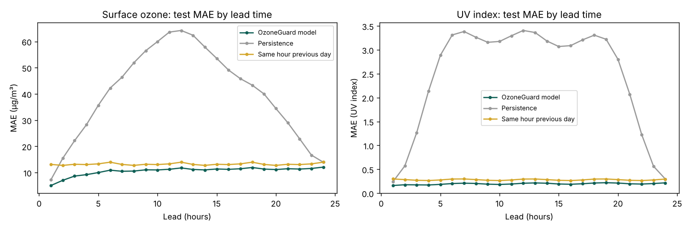
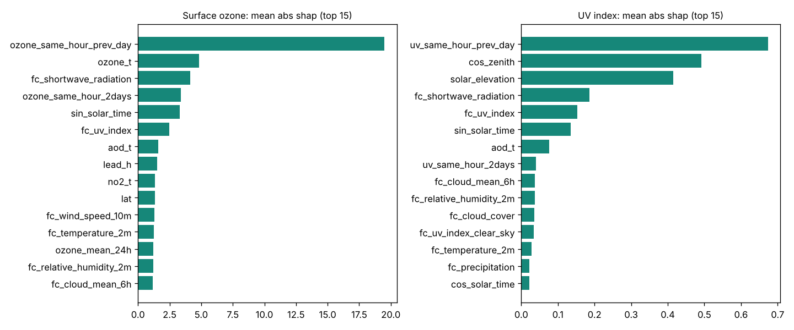

# ML results

Generated from `models/xgboost/metrics.json` by `python -m ml.report` (training run 2026-10-07T06:31:15.519322+00:00).

All numbers are measured on real data (CAMS + archived NWP forecasts, 38 Indian locations). Targets: **surface ozone (µg/m³)** and **all-sky UV index**, both from CAMS (model-derived truth — see scientific-limitations.md).

## Data and splits

| Split | Issue-time period (UTC) | Rows (location × issue time × lead) |
|---|---|---|
| Train | 2022-08-04 → 2024-09-30 | 2,270,716 |
| Validation | 2024-10-01 → 2025-09-30 | 1,050,000 |
| Test (used once) | 2025-10-01 → 2026-10-05 | 1,064,400 |
| Spatial holdout (8 never-trained locations, all periods) | — | 1,169,974 |

Model-family benchmarks were trained on a random 600,000-row subsample of the training period (2-CPU budget); the selected family was then refit on the full training period.

## Surface ozone — validation benchmark (µg/m³)

| Model | Train time (s) | Val MAE | Val RMSE | Val R² | Inference (ms / 1k rows) | Size (MB) |
|---|---|---|---|---|---|---|
| *Baseline:* Persistence (latest value at issue time) | — | 38.988 | 53.859 | -0.400 | — | — |
| *Baseline:* Same hour, previous day | — | 13.685 | 19.372 | 0.819 | — | — |
| *Baseline:* Climatology (train-period month × hour mean) | — | 17.987 | 24.162 | 0.718 | — | — |
| Ridge | 2.8 | 12.708 | 17.508 | 0.852 | 0.66 | 0.0 |
| RandomForest | 167.5 | 11.545 | 16.074 | 0.875 | 10.36 | 292.21 |
| HistGradientBoosting | 29.5 | 10.925 | 15.220 | 0.888 | 13.45 | 4.34 |
| XGBoost **(selected)** | 47.3 | 10.806 | 15.038 | 0.891 | 6.81 | 8.97 |
| LightGBM | 45.1 | 10.806 | 15.049 | 0.891 | 61.2 | 10.2 |

Direct single multi-horizon model vs 24 per-horizon models (XGBoost, same subsample): MAE 10.806 vs 10.904 (train 47.3 s vs 116.0 s).

Final XGBoost refit on the full training period — validation MAE 10.761, RMSE 14.985, R² 0.892.

## UV index — validation benchmark (UV index)

| Model | Train time (s) | Val MAE | Val RMSE | Val R² | Inference (ms / 1k rows) | Size (MB) |
|---|---|---|---|---|---|---|
| *Baseline:* Persistence (latest value at issue time) | — | 2.394 | 3.819 | -1.342 | — | — |
| *Baseline:* Same hour, previous day | — | 0.309 | 0.825 | 0.891 | — | — |
| *Baseline:* Climatology (train-period month × hour mean) | — | 0.336 | 0.792 | 0.899 | — | — |
| *Baseline:* Raw NWP UV forecast (Open-Meteo best_match) | — | 0.589 | 1.157 | 0.785 | — | — |
| Ridge | 2.7 | 0.275 | 0.649 | 0.932 | 0.59 | 0.0 |
| RandomForest | 124.0 | 0.222 | 0.568 | 0.948 | 5.65 | 177.84 |
| HistGradientBoosting | 19.0 | 0.215 | 0.549 | 0.952 | 9.29 | 4.33 |
| XGBoost **(selected)** | 30.4 | 0.212 | 0.547 | 0.952 | 6.45 | 6.87 |
| LightGBM | 30.7 | 0.214 | 0.549 | 0.952 | 23.98 | 10.29 |

Direct single multi-horizon model vs 24 per-horizon models (XGBoost, same subsample): MAE 0.212 vs 0.218 (train 30.4 s vs 86.1 s).

Final XGBoost refit on the full training period — validation MAE 0.211, RMSE 0.545, R² 0.952.

## Does ozone help the UV forecast? (validation ablation)

| UV model variant | Val MAE | Val RMSE | Val R² |
|---|---|---|---|
| no ozone | 0.212 | 0.547 | 0.952 |
| with observed surface ozone lags | 0.212 | 0.546 | 0.952 |
| with predicted surface ozone | 0.212 | 0.547 | 0.952 |

Decision rule: keep an ozone input only if validation MAE improves by >= 1 %. **Decision: `no_ozone`.**

## Test-period results (evaluated once)

### Surface ozone (µg/m³)

| Forecast | MAE | RMSE | R² | n |
|---|---|---|---|---|
| **OzoneGuard model** | **10.574** | **14.658** | **0.895** | 1,064,400 |
| Persistence (latest value at issue time) | 40.107 | 55.110 | -0.490 | 1,064,400 |
| Same hour, previous day | 13.208 | 18.717 | 0.828 | 1,064,400 |
| Climatology (train-period month × hour mean) | 18.327 | 24.673 | 0.701 | 1,064,400 |

* Native CAMS hours only (00, 03, …, 21 UTC): MAE 11.139, R² 0.887
* 90 % conformal range: empirical coverage **90.3%**, mean width 47.12 µg/m³
* Alternative (LightGBM 5–95 % quantile regression): coverage 88.9%, mean width 45.49
* **Unseen locations** (spatial holdout, test period): MAE 10.978, RMSE 14.637, R² 0.882, range coverage 89.4%

Test MAE by region:

| Region | MAE | R² | n |
|---|---|---|---|
| Central | 9.483 | 0.890 | 141,920 |
| East | 11.724 | 0.897 | 141,920 |
| North | 12.436 | 0.891 | 212,880 |
| Northeast | 9.227 | 0.893 | 141,920 |
| South | 10.125 | 0.891 | 248,360 |
| West | 9.996 | 0.893 | 177,400 |

Selected leads:

| Lead (h) | Model MAE | Persistence MAE | Same-hour-prev-day MAE |
|---|---|---|---|
| 1 | 5.043 | 7.259 | 13.088 |
| 3 | 8.646 | 22.175 | 13.154 |
| 6 | 10.899 | 42.234 | 13.944 |
| 12 | 11.750 | 64.211 | 13.943 |
| 18 | 11.919 | 43.337 | 13.942 |
| 24 | 12.061 | 13.942 | 13.942 |

### UV index (UV index)

| Forecast | MAE | RMSE | R² | n |
|---|---|---|---|---|
| **OzoneGuard model** | **0.196** | **0.501** | **0.962** | 1,064,400 |
| Persistence (latest value at issue time) | 2.479 | 3.929 | -1.351 | 1,064,400 |
| Same hour, previous day | 0.281 | 0.757 | 0.913 | 1,064,400 |
| Climatology (train-period month × hour mean) | 0.315 | 0.728 | 0.919 | 1,064,400 |
| Raw NWP UV forecast (Open-Meteo best_match) | 0.573 | 1.119 | 0.809 | 1,064,400 |

* Native CAMS hours only (00, 03, …, 21 UTC): MAE 0.199, R² 0.961
* Daytime only (sun above horizon): MAE 0.391, RMSE 0.708, R² 0.938
* 90 % conformal range: empirical coverage **91.2%**, mean width 1.06 UV index
* Alternative (LightGBM 5–95 % quantile regression): coverage 94.5%, mean width 0.87
* **Unseen locations** (spatial holdout, test period): MAE 0.205, RMSE 0.529, R² 0.960, range coverage 90.9%

Test MAE by region:

| Region | MAE | R² | n |
|---|---|---|---|
| Central | 0.182 | 0.966 | 141,920 |
| East | 0.185 | 0.955 | 141,920 |
| North | 0.191 | 0.959 | 212,880 |
| Northeast | 0.232 | 0.918 | 141,920 |
| South | 0.222 | 0.965 | 248,360 |
| West | 0.155 | 0.977 | 177,400 |

Selected leads:

| Lead (h) | Model MAE | Persistence MAE | Same-hour-prev-day MAE |
|---|---|---|---|
| 1 | 0.160 | 0.241 | 0.297 |
| 3 | 0.174 | 1.267 | 0.270 |
| 6 | 0.201 | 3.312 | 0.296 |
| 12 | 0.208 | 3.406 | 0.295 |
| 18 | 0.213 | 3.307 | 0.295 |
| 24 | 0.217 | 0.296 | 0.296 |

### UV risk category (WHO bands, from the continuous forecast)

**daytime only** — accuracy 0.863, macro-F1 0.768, weighted-F1 0.863

| Class | Precision | Recall | F1 | Support |
|---|---|---|---|---|
| Low | 0.961 | 0.945 | 0.953 | 268,367 |
| Moderate | 0.806 | 0.847 | 0.826 | 146,463 |
| High | 0.657 | 0.690 | 0.673 | 65,239 |
| Very High | 0.798 | 0.727 | 0.761 | 47,851 |
| Extreme | 0.797 | 0.514 | 0.625 | 5,426 |

Confusion matrix (rows = CAMS category, columns = forecast category; Low, Moderate, High, Very High, Extreme):

```
  253526     14288       524        29         0
   10176    124089     11399       795         4
      44     14698     45024      5449        24
      10       889     11493     34778       681
       0        19       105      2512      2790
```

**all hours** — accuracy 0.931, macro-F1 0.774, weighted-F1 0.932

| Class | Precision | Recall | F1 | Support |
|---|---|---|---|---|
| Low | 0.987 | 0.981 | 0.984 | 799,421 |
| Moderate | 0.806 | 0.847 | 0.826 | 146,463 |
| High | 0.657 | 0.690 | 0.673 | 65,239 |
| Very High | 0.798 | 0.727 | 0.761 | 47,851 |
| Extreme | 0.797 | 0.514 | 0.625 | 5,426 |

Confusion matrix (rows = CAMS category, columns = forecast category; Low, Moderate, High, Very High, Extreme):

```
  784580     14288       524        29         0
   10176    124089     11399       795         4
      44     14698     45024      5449        24
      10       889     11493     34778       681
       0        19       105      2512      2790
```

## Does ML beat the simple baselines?

* **Surface ozone: Yes.** Test MAE 10.574 vs best baseline 'Same hour, previous day' 13.208 (+19.9% relative MAE reduction).
* **UV index: Yes.** Test MAE 0.196 vs best baseline 'Same hour, previous day' 0.281 (+30.4% relative MAE reduction).

## How to read these numbers

* **UV all-hours scores are flattered by night.** About half the rows are night (UV = 0, trivially right). The honest daytime UV error is MAE 0.391 (R² 0.938).
* **Extremes are under-forecast.** Daytime recall for 'Extreme' is 0.514 and for 'High' 0.690; most misses fall one category lower. Use the upper end of the range (`possible_high_risk_windows_upper_bound`) for caution.
* **Error grows with lead time** (ozone MAE 5.043 at 1 h → 12.061 at 24 h), and by 24 h the advantage over 'same hour yesterday' is smaller.
* **Surface ozone did not improve the UV forecast** (ablation). This matches the physics: UV is attenuated by the *column* ozone, mostly stratospheric, not by near-ground ozone. A total-column-ozone feature (blocked, see blockers.md) is the physically relevant test.
* **The skill is relative to CAMS.** These scores say how well we reproduce CAMS, not ground monitors (scientific-limitations.md).
* **Unseen locations perform close to seen ones** (spatial holdout), so the medium-quality tier is supported up to ~300 km from a training point.

## Explainability (validation, measured)

### Surface ozone

| Rank | Mean |SHAP| | Permutation (MAE increase) |
|---|---|---|
| 1 | ozone_same_hour_prev_day (19.504) | ozone_same_hour_prev_day (9.750) |
| 2 | ozone_t (4.837) | ozone_t (5.930) |
| 3 | fc_shortwave_radiation (4.149) | fc_shortwave_radiation (2.194) |
| 4 | ozone_same_hour_2days (3.380) | sin_solar_time (1.854) |
| 5 | sin_solar_time (3.325) | lead_h (1.848) |
| 6 | fc_uv_index (2.486) | fc_uv_index (1.191) |
| 7 | aod_t (1.582) | lat (0.954) |
| 8 | lead_h (1.538) | fc_wind_speed_10m (0.835) |
| 9 | no2_t (1.349) | ozone_same_hour_2days (0.736) |
| 10 | lat (1.347) | ozone_mean_24h (0.676) |

### UV index

| Rank | Mean |SHAP| | Permutation (MAE increase) |
|---|---|---|
| 1 | uv_same_hour_prev_day (0.673) | uv_same_hour_prev_day (0.465) |
| 2 | cos_zenith (0.491) | cos_zenith (0.322) |
| 3 | solar_elevation (0.415) | solar_elevation (0.297) |
| 4 | fc_shortwave_radiation (0.186) | fc_uv_index (0.180) |
| 5 | fc_uv_index (0.153) | fc_shortwave_radiation (0.165) |
| 6 | sin_solar_time (0.135) | sin_solar_time (0.096) |
| 7 | aod_t (0.076) | uv_same_hour_2days (0.073) |
| 8 | uv_same_hour_2days (0.040) | fc_uv_index_clear_sky (0.058) |
| 9 | fc_cloud_mean_6h (0.036) | aod_t (0.044) |
| 10 | fc_relative_humidity_2m (0.036) | cos_solar_time (0.025) |

## Prediction-quality evidence (never-trained locations, test period)

| Holdout location | Distance to nearest training point (km) | Ozone MAE | UV MAE |
|---|---|---|---|
| amritsar | 207.4 | 13.829 | 0.139 |
| imphal | 222.9 | 11.725 | 0.266 |
| indore | 169.6 | 8.820 | 0.182 |
| jodhpur | 285.4 | 9.634 | 0.152 |
| kurnool | 180.0 | 8.611 | 0.216 |
| madurai | 202.6 | 12.366 | 0.263 |
| panaji | 308.7 | 10.022 | 0.217 |
| ranchi | 250.8 | 12.816 | 0.209 |

## Figures



